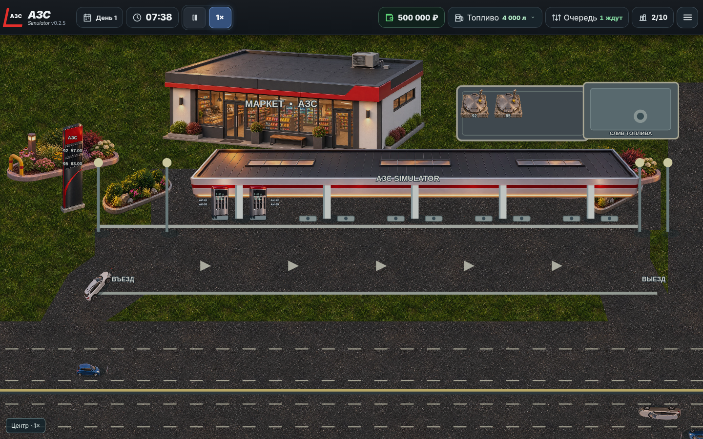

# АЗС Simulator v0.2.5

## Графика

Сцена остаётся объектной: покрытия, здание, навес, опоры, ТРК, ценовая стела, люки резервуаров, озеленение и каждый автомобиль имеют собственные объекты PixiJS. Дороги и площадка под навесом используют текстуры, ограниченные геометрическими масками. Дисплеи ТРК и стелы, бирки топлива, шланги, прогресс заправки и позиции строительства обновляются из состояния симуляции.

В `src/assets/v025/` находятся WebP-версии созданных для релиза растровых ресурсов. Исходные запросы к генератору описывали фотореалистичные игровые объекты в едином высоком ракурсе, с тёплым вечерним светом, прозрачным фоном и без текста: магазин, крыша навеса без опор, корпус ТРК, стела с пустыми дисплеями, люк резервуара, цветники, газон и асфальт. Два атласа задавали десять разных легковых кузовов и пять типов коммерческого транспорта; пикап создан отдельно. Исходные PNG преобразованы в WebP с сохранением альфа-канала. Геометрия движения и параметры машин остались в игровой модели.

## Проверки

- `npm test`: 34 теста прошли, включая загрузку сохранения v0.2.4.
- `npm run android:sync`: TypeScript, Vite и копирование ресурсов в Android прошли.
- Браузерные проверки 1440×900 и 900×420: сцена загружается без ошибок страницы.
- Браузерная проверка 10×: часы, очередь, продажи и остатки изменяются; ошибок страницы нет.

Локальная сборка APK требует установленный Android SDK. Релизный workflow устанавливает SDK в GitHub Actions и собирает подписанный APK.

## Ручные проверки

1. Открыть новую игру: две ТРК у первой опоры, пять опор и десять монтажных мест.
2. Проследить за десятью легковыми кузовами, фургоном, грузовиком, автобусом и бензовозом на трассе, въезде и выезде.
3. Дождаться заправки и проверить показания дисплея, шланг, бирку топлива, рост баланса и снижение остатка.
4. Построить третью ТРК и модернизировать существующую: проверить анимацию работ и появление новых каналов.
5. Заказать топливо: проверить прибытие, подключение, слив, отключение и заполнение отдельного резервуара.
6. Установить 10×, провести несколько игровых часов и проверить очереди, отсутствие наложения машин и корректность продаж.
7. Сохранить игру, перезагрузить страницу, загрузить сохранение v0.2.4 и проверить деньги, остатки, строительство и трафик.
8. Повторить основные действия на узком экране и в Android-приложении.

## Известное ограничение

Полуприцеп и бензовоз используют жёсткий габаритный прямоугольник на повороте; отдельная кинематика прицепа не реализована.
