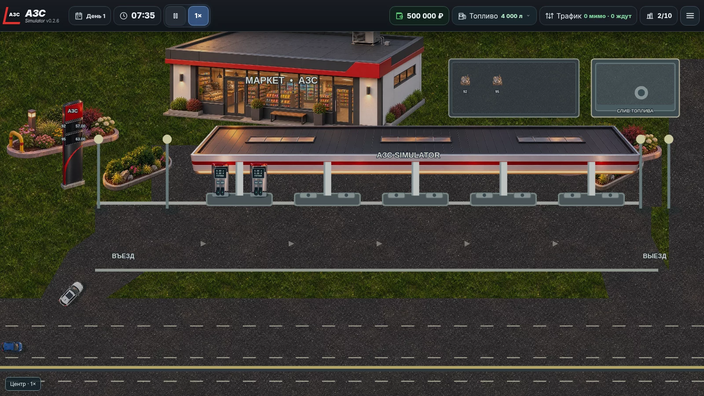
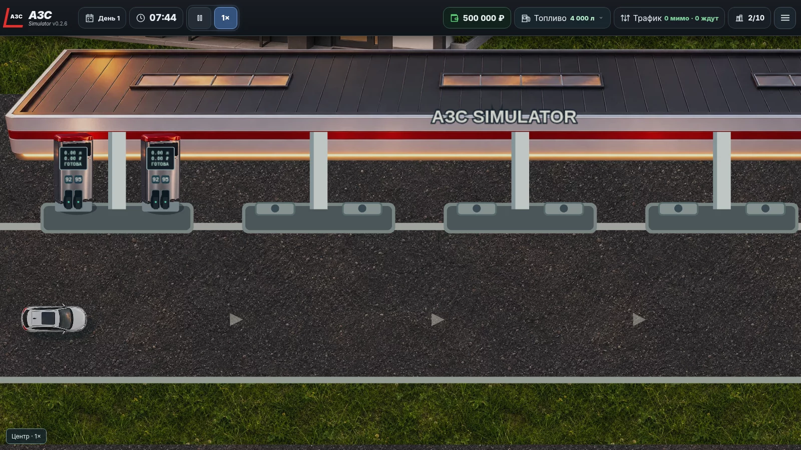

# АЗС Simulator v0.2.6

## Исправления

- Десять монтажных мест сгруппированы по два у каждой из пяти опор. Две стартовые ТРК стоят на отдельных симметричных позициях, остановки автомобилей отнесены от корпусов и опор.
- Для десяти легковых и пяти грузовых классов применены отдельные детализированные модели в ракурсе сверху. Точки вращения и размеры согласованы с геометрией столкновений.
- Подъезд и выезд из ТРК проходят через отдельные точки поворота, выравнивания и освобождения места. Пересекающиеся траектории соседних островков резервируются на время манёвра.
- Корпус ТРК не содержит нарисованных заранее пистолетов. Держатели, шланги, бирки и индикаторы создаются по фактически подключённым каналам; пустой канал помечается красным индикатором. Табло показывает данные текущей продажи.
- Шланг заправки идёт от соответствующего пистолета к лючку на заднем боковом крыле автомобиля. Литры и полоса прогресса размещены ниже машины.
- Уменьшены люки подземных резервуаров, разделены площадки резервуаров и слива, добавлена фактура покрытия. Бензовоз использует отдельную точку слива.
- Стела получает цены и доступность из активных резервуаров. Если установлено более двух видов топлива, она показывает их парами по очереди; пустые строки не заполняются вымышленными видами топлива.
- Разметка стрелок уменьшена. HUD всегда показывает число проехавших мимо и ожидающих машин; остальные категории доступны в статистике.
- Сохранения v0.2.5 переносят стоящие у ТРК автомобили на новые точки остановки, сохраняя выданное топливо, деньги и заказанные объёмы.

## Проверки

- `npm run build` и `npm test`: 40 тестов прошли.
- Длительные прогоны на 10×: два игровых дня, все десять ТРК и четыре дорожные полосы, без пересечений габаритов и остановки очереди.
- Проверены одновременно обслуживаемые машины, строительство третьей ТРК, отсутствие топлива, рейсы двух бензовозов, пауза и загрузка сохранений v0.2.3–v0.2.5.
- Браузерная сцена проверена при 1× и 2× без ошибок страницы. Масштаб 0.5× не поддерживается камерой; минимум 1×.

## Ручная проверка

1. Начать новую игру: две ТРК, пять опор, десять монтажных мест и два небольших люка.
2. Приблизить камеру до 2×: у каждой стартовой ТРК только два пистолета с бирками «92» и «95»; табло и шланги остаются на своих местах.
3. Проследить за машиной от трассы до ТРК и обратно: плавный поворот, правильная ориентация, расстояние до соседей, подключение у заднего бокового крыла.
4. Построить третью ТРК, проверить анимацию монтажа и счётчик 3/10; затем модернизировать колонку.
5. Израсходовать один вид топлива: его пистолет и цена становятся недоступными, второй вид продолжает работать.
6. Заказать бензовоз: он занимает отдельную площадку, подключает шланг, перекачивает фактический объём и выезжает.
7. Переключить 10×, наблюдать несколько одновременных заправок, очередь и статистику; проверить паузу.
8. Сохранить игру с машиной у ТРК, перезагрузить страницу и продолжить продажу; повторить с сохранением v0.2.5.

## Ограничения

- У полуприцепа и бензовоза остаётся единый жёсткий габарит на повороте; отдельная кинематика прицепа не реализована.
- При 3.5× растровые текстуры могут выглядеть менее чётко.
