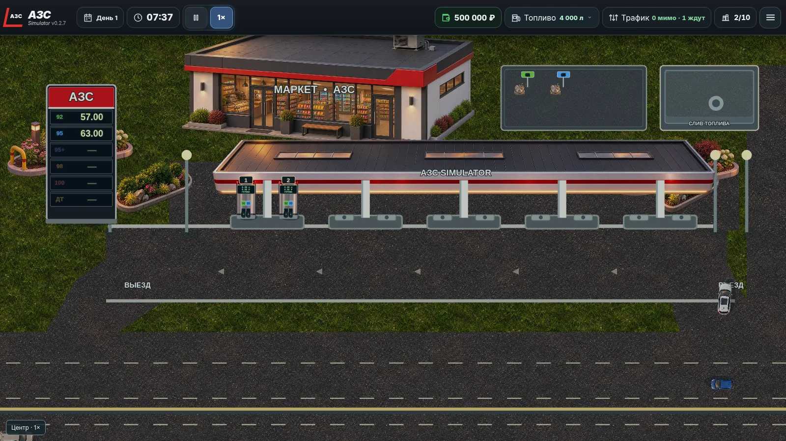
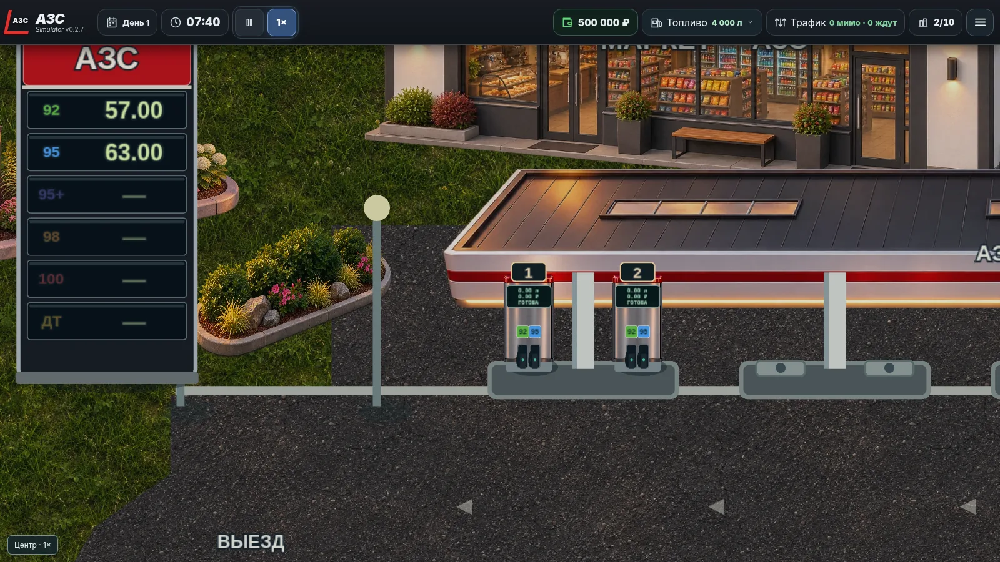
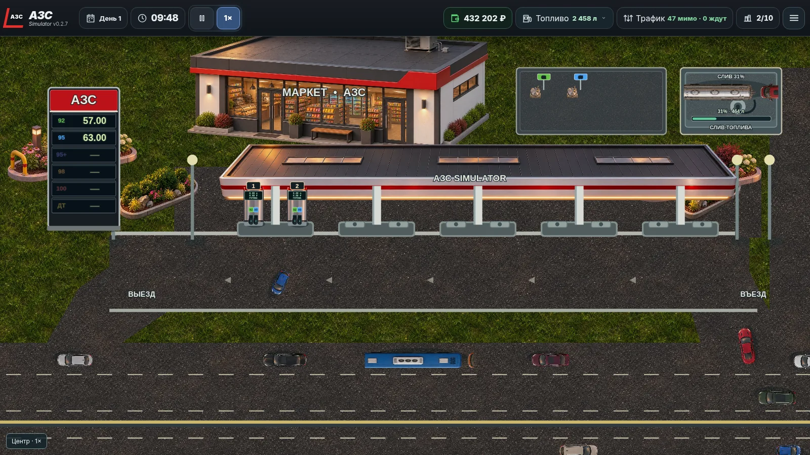

# АЗС Simulator v0.2.7

## Исправленные дефекты

- Стела полностью перерисована объектами PixiJS. Все шесть видов топлива находятся на отдельных светящихся строках одновременно; цена считывается из игрового состояния. При отсутствии активного запаса строка приглушается и показывает «—».
- ТРК получила новый фронтальный корпус без нарисованных пистолетов. Настоящее цифровое табло помещено в окно корпуса. Крупный номер сверху, цветные карточки топлива и пистолеты создаются по настроенным каналам; пустой канал показывает недоступность отдельно.
- Ближние к АЗС полосы трассы направлены на запад, дальние — на восток. Въезд перенесён на восточную сторону, выезд — на западную. Маршруты, очередь и выпуск клиентов приведены к правостороннему движению.
- Устранены застревания на точках маршрута и пересечения автомобилей в плотном потоке. Длинные автобусы и грузовики не заезжают к ТРК, которым не соответствуют их габариты.
- Над каждым технологическим люком добавлен цветной маркер на стойке с обозначением вида топлива.
- Срок прибытия нового бензовоза увеличен до двух игровых часов. Площадка слива показывает обратный отсчёт; при разгрузке — фактический объём и процент на шкале. Время перекачки зависит от количества топлива. Подпись стадии закреплена внутри площадки.
- Загрузка сохранений v0.2.3–v0.2.6 переносит транспорт на новое направление дороги и сохраняет продажи, баланс, остатки, стройку и заказы топлива.

## Проверки

- `npm test`: 44 теста, включая все виды стелы, правосторонние маршруты, коллизии в плотном потоке на 10×, время и объём разгрузки, восстановление сохранений.
- `npm run build`: успешно. Vite сообщает о крупном основном JS-файле; на работу это не влияет.
- Сцена проверена в браузере при 1× и 2×: стела, ТРК, маркеры резервуаров, таймер и шкала разгрузки. Ошибок страницы не было.

## Ручная проверка

1. Начать новую игру: стела показывает 92 и 95 с ценами, а 95+, 98, 100 и ДТ — приглушёнными строками. У двух стартовых ТРК по два цветных пистолета и номера 1 и 2.
2. Приблизить камеру до 2×: табло внутри корпуса, пистолеты и бирки не смещаются.
3. Проследить автомобили на четырёх полосах: две верхние едут влево, две нижние — вправо; клиенты въезжают справа и выезжают слева.
4. Дать транспорту поработать на 10×: проверить повороты, дистанции, отсутствие наложений и работу нескольких ТРК.
5. Построить третью ТРК: появляется номер 3 и счётчик 3/10; подключить другой вид топлива и сверить цветные карточки с пистолетами.
6. Израсходовать один вид топлива: его строка на стеле и пистолет становятся недоступными, другой канал продолжает обслуживание.
7. Заказать топливо: проверить обратный отсчёт, прибытие бензовоза, подключение шланга и шкалу разгрузки до 100%.
8. Сохранить игру во время продажи или доставки и загрузить её. Повторить с сохранением v0.2.6; проверить деньги, топливо, заказы и продолжение движения.
9. Проверить паузу и скорости 1×, 2×, 10×: таймер и количество разгруженного топлива должны изменяться только в игровое время.

## Ограничения

- Полуприцеп и бензовоз поворачивают с единым жёстким габаритом; отдельной кинематики прицепа нет.
- При максимальном увеличении 3.5× часть растровых текстур выглядит менее чёткой.
